# Mermaid examples

One diagram of every type usta draws, for the tests: each reads and lays
out, and its layout is kept under test/golden/diagrams.

## architecture

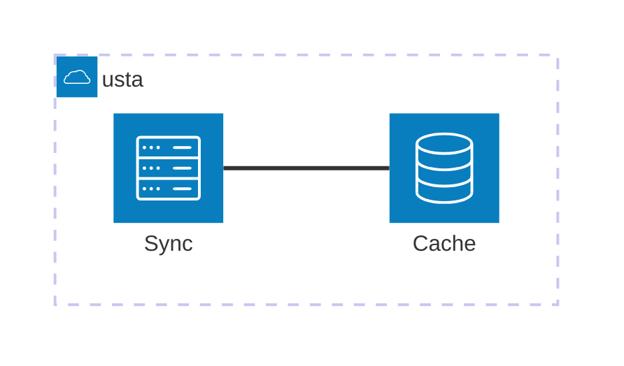

## block

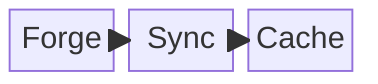

## c4

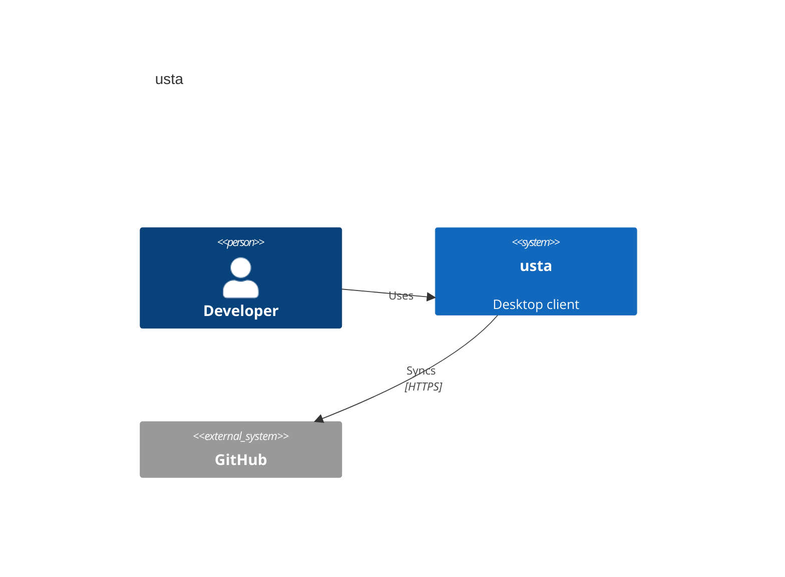

## class

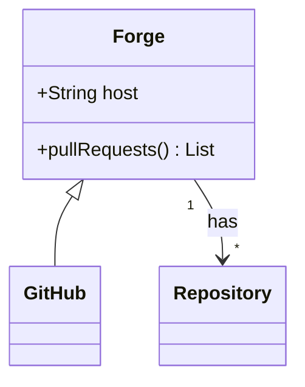

## entity

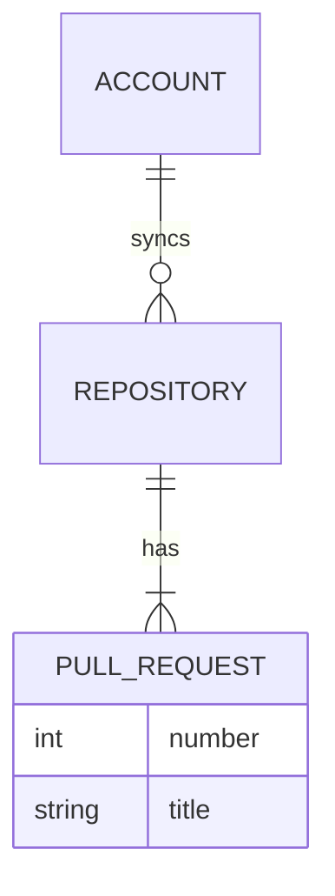

## flowchart

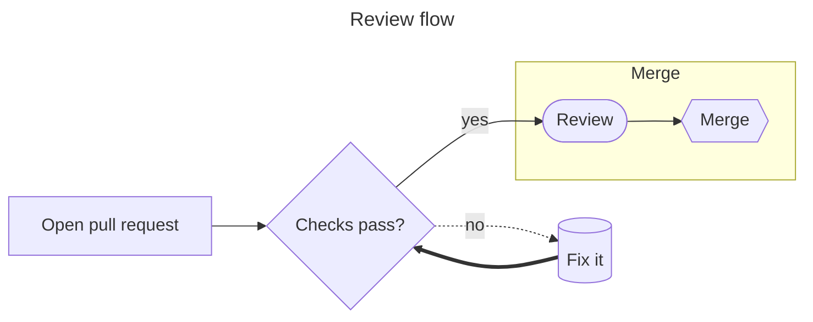

## gantt

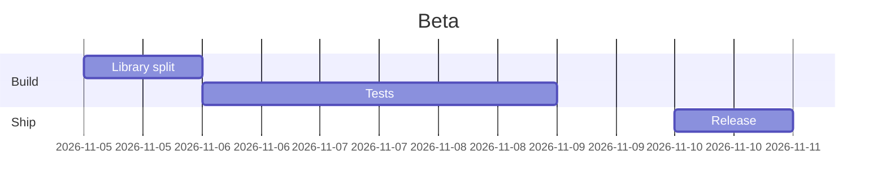

## gitgraph

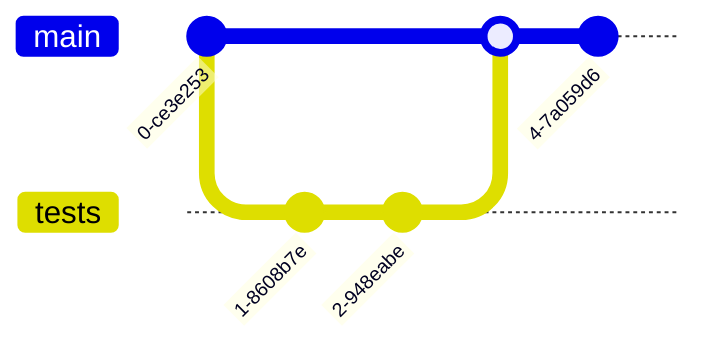

## journey

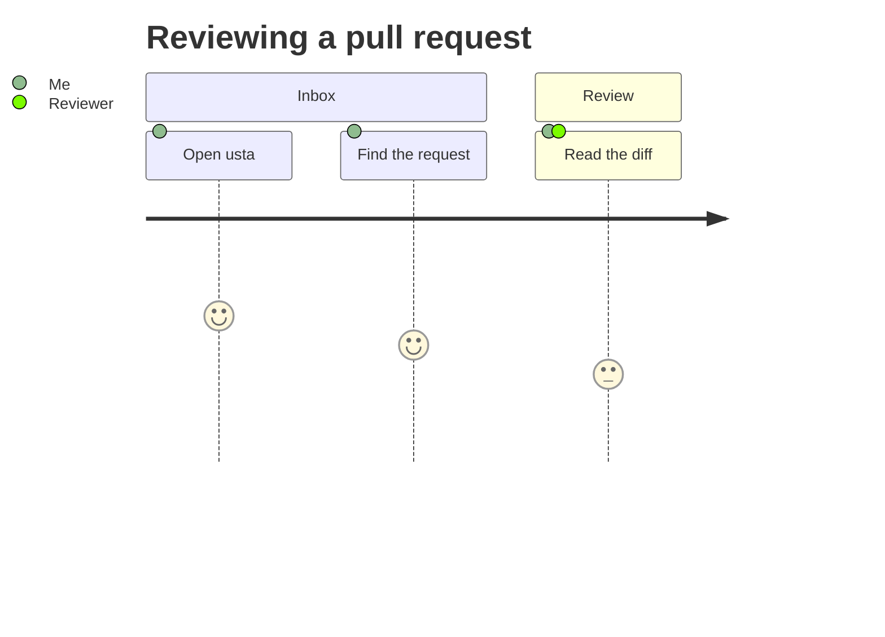

## kanban

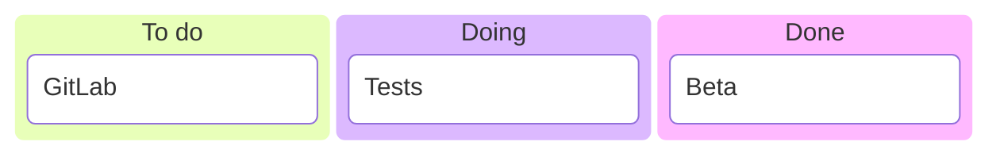

## mindmap

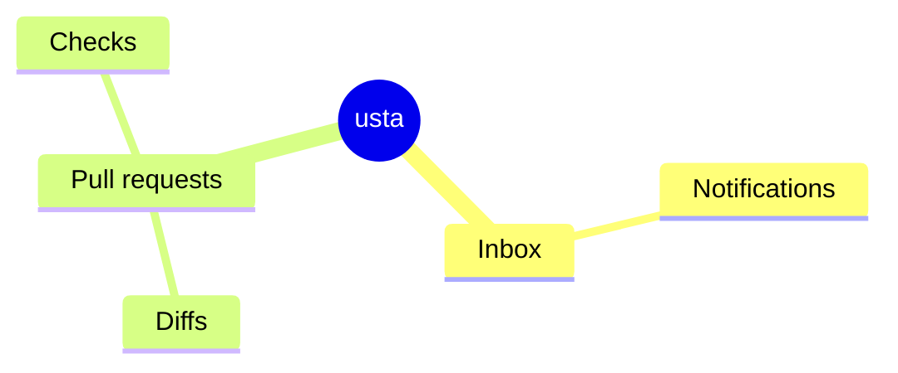

## packet

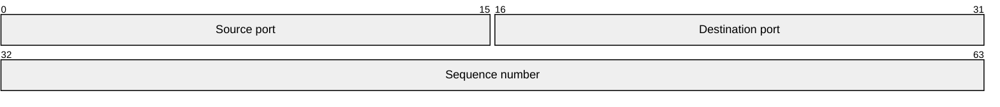

## pie

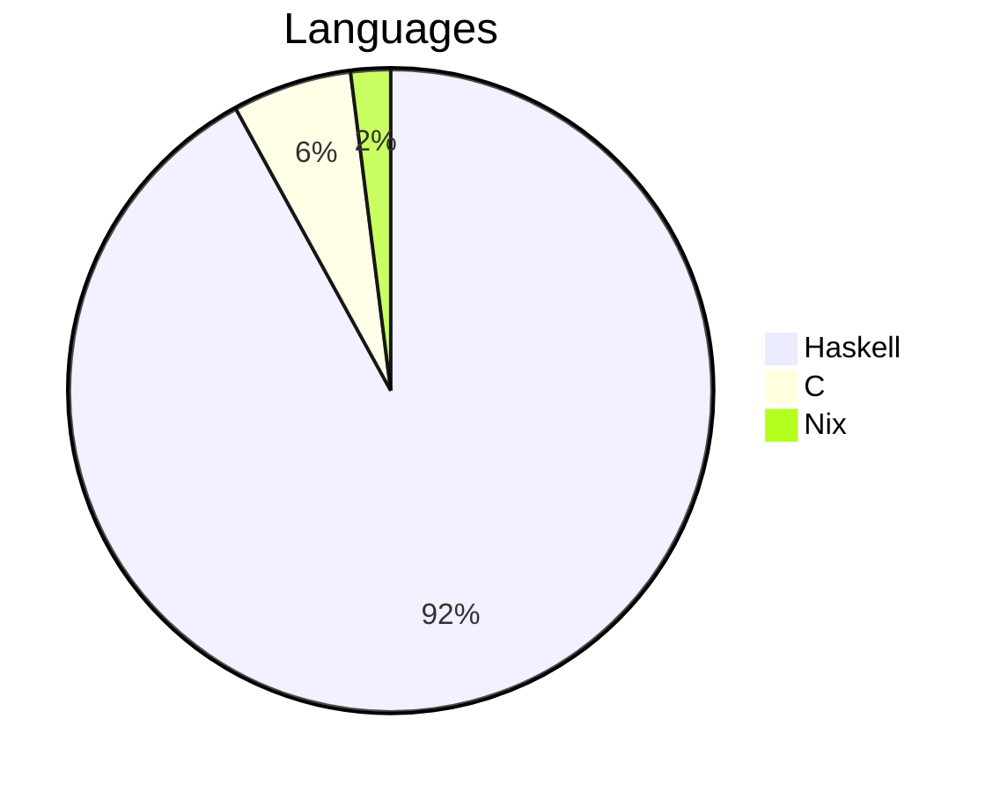

## quadrant

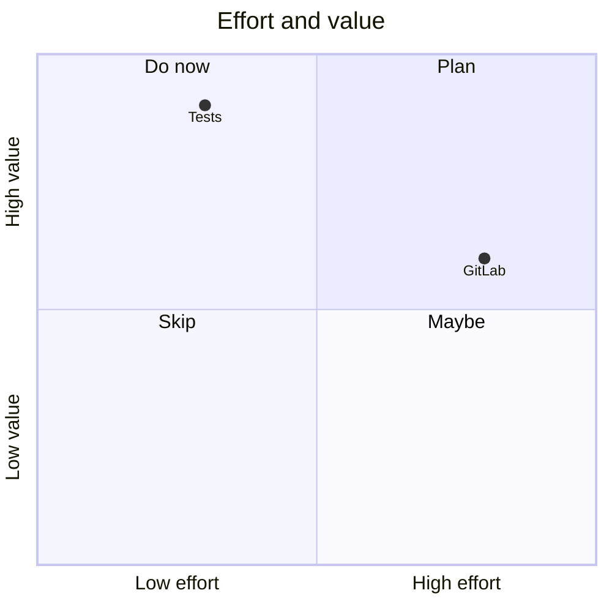

## radar

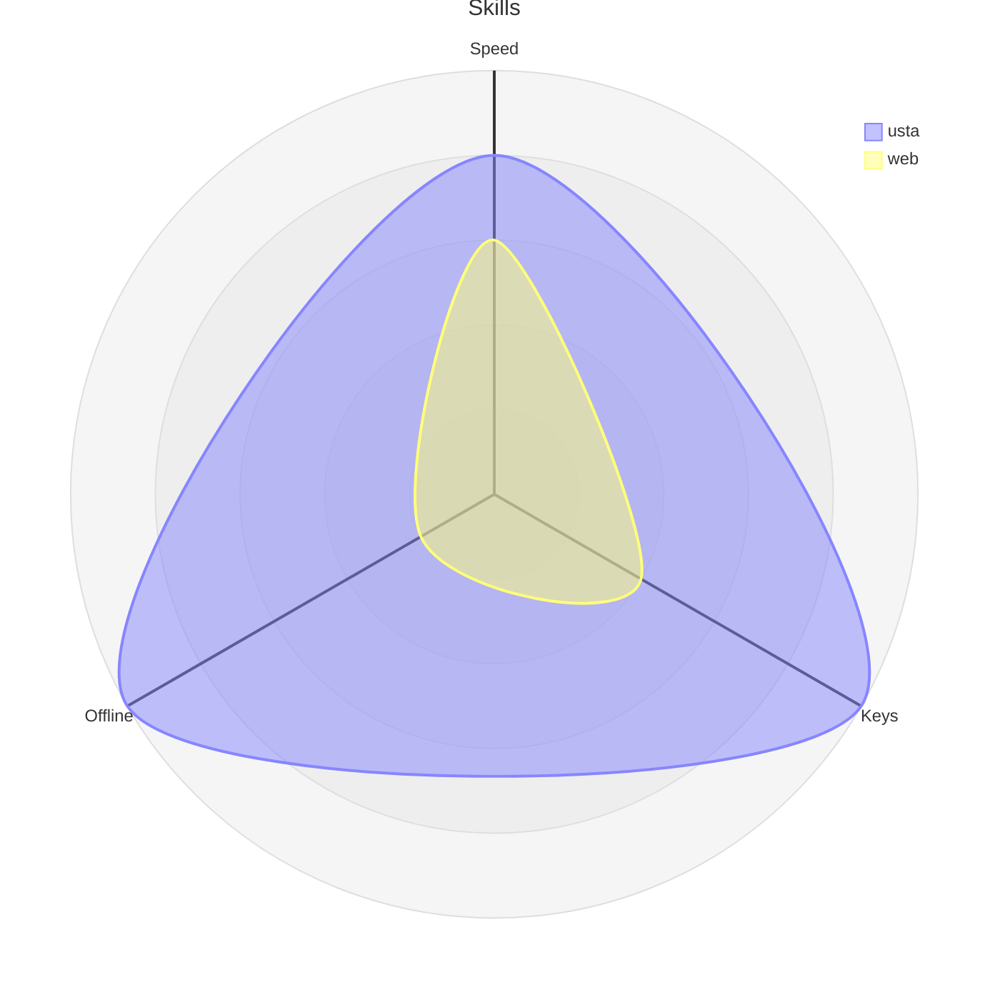

## requirement

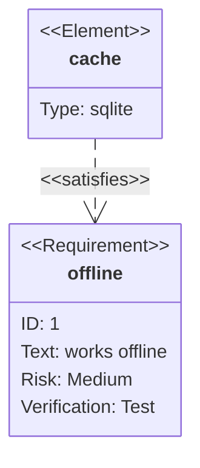

## sankey

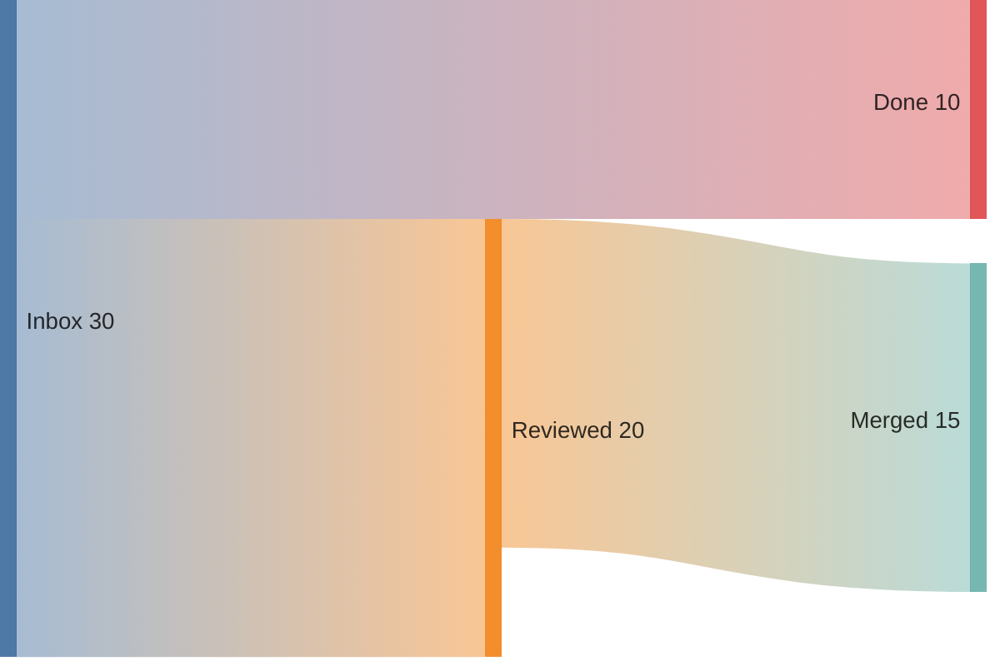

## sequence

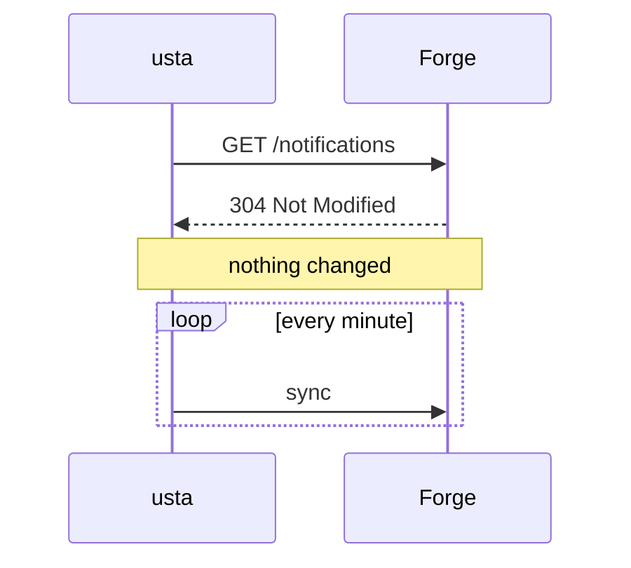

## state

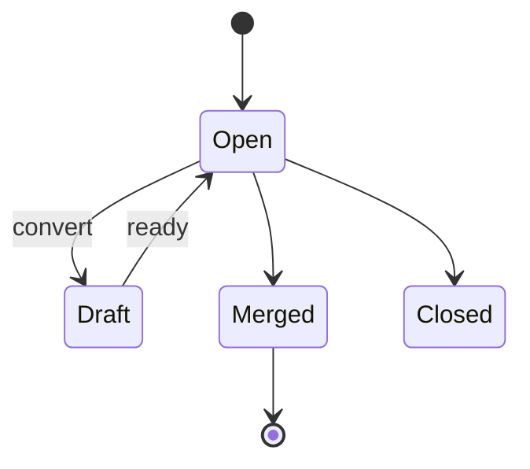

## timeline

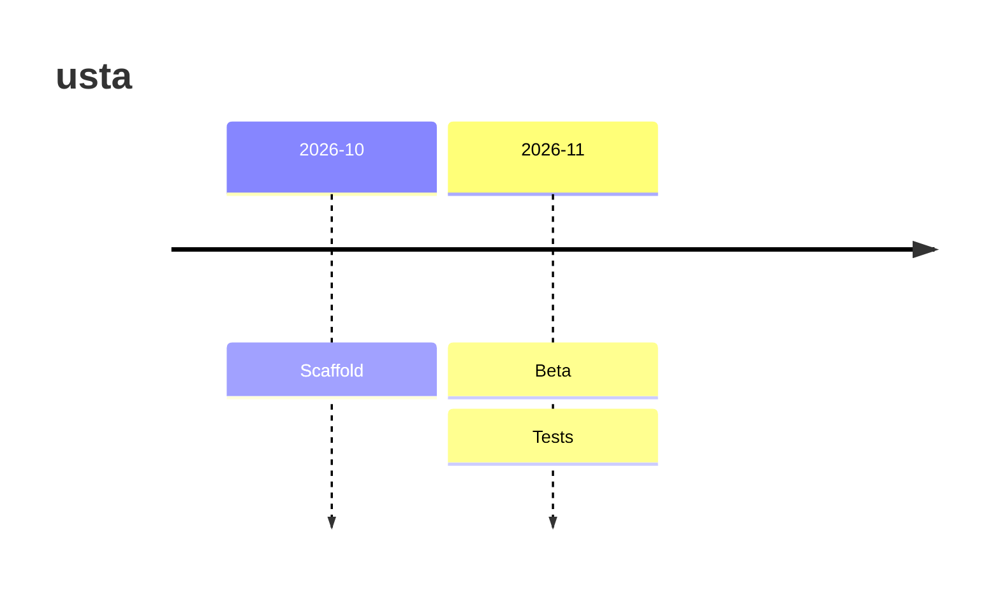

## treemap

```mermaid
treemap-beta
"src"
  "UI": 120
  "Forge": 40
"test"
  "unit": 30
```

## xychart

```mermaid
xychart-beta
  title "Pull requests"
  x-axis [jan, feb, mar, apr]
  y-axis "Count" 0 --> 50
  bar [10, 20, 35, 42]
  line [8, 18, 30, 40]
```

## zenuml

```mermaid
zenuml
  Alice->Bob: Hello
  Bob->Alice: Hi
```
